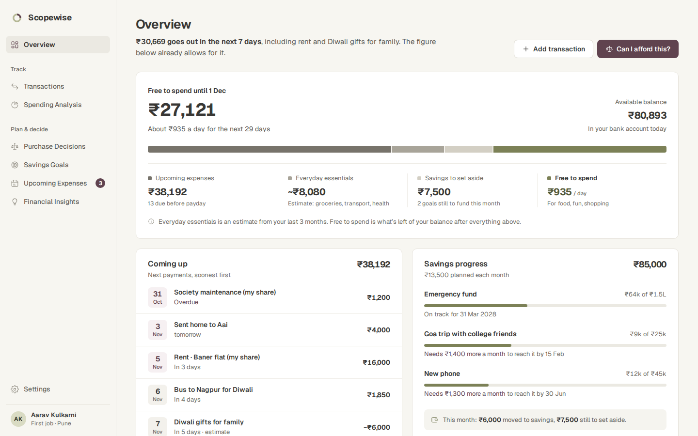
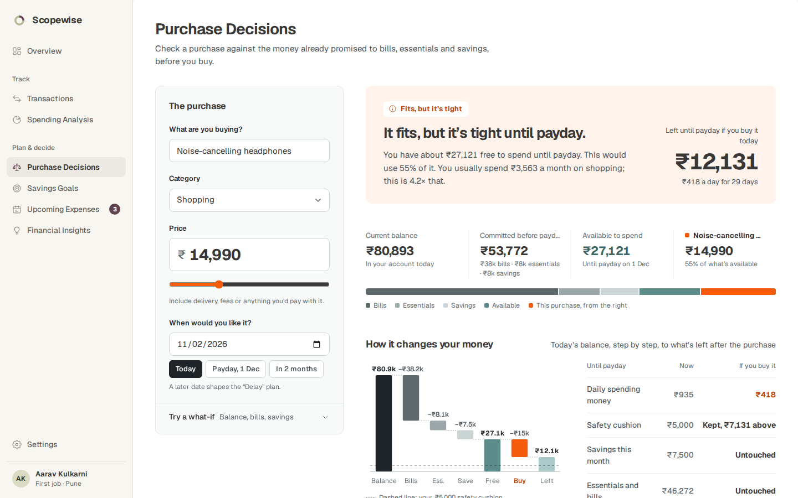
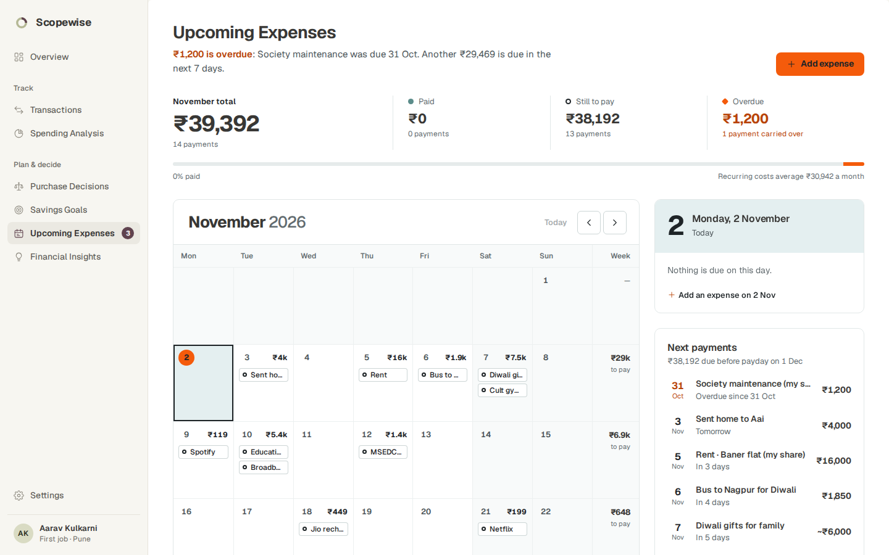
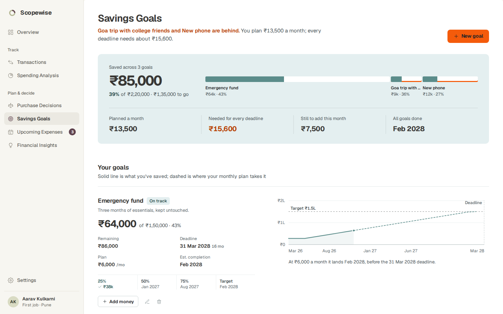
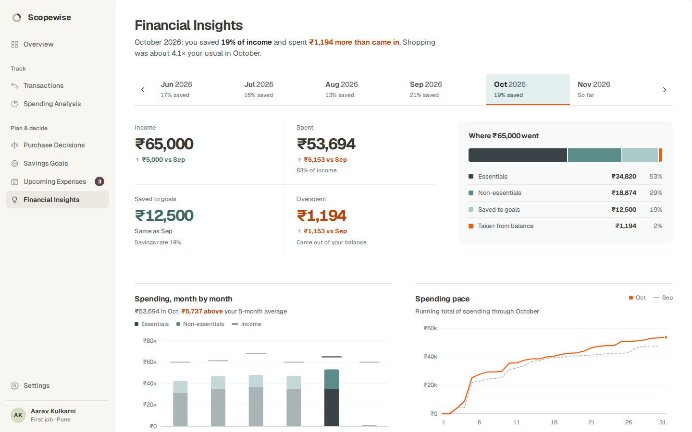
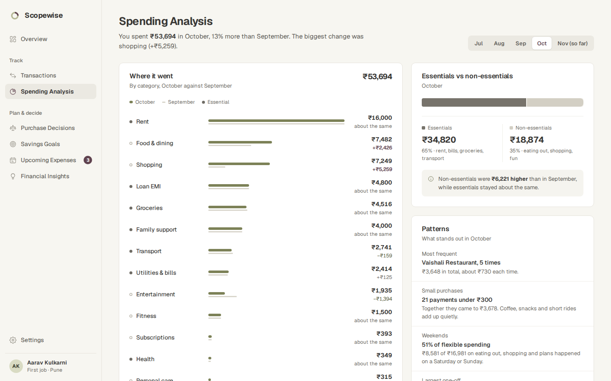
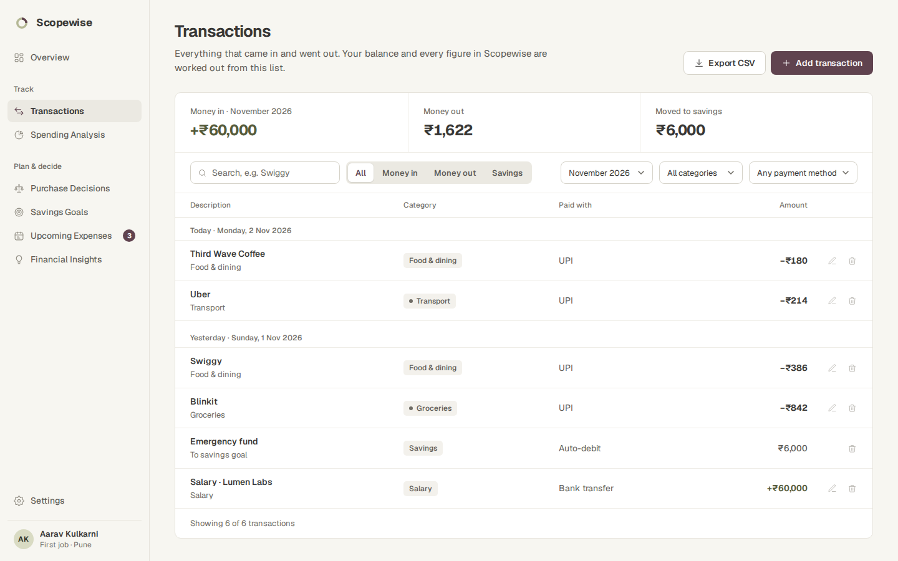

# Scopewise: Personal Finance Tracker

**A personal finance app that answers one question before you spend: _"Can I afford this without affecting my other goals?"_**

Scopewise brings income and expense tracking, spending analysis, savings goals, an upcoming-expenses calendar and a purchase-decision checker together in one calm, focused interface. It's built for individuals managing their own money, not for businesses.



---

## Overview

Most expense trackers look backwards: they tell you where your money went. Scopewise also looks forwards. It splits your bank balance into four layers up to your next payday:

1. **Upcoming expenses**: bills and planned costs already due before payday
2. **Everyday essentials**: an estimate from your recent spending on groceries, transport and health
3. **Savings to set aside**: what your goals still need this month
4. **Free to spend**: what's genuinely left, shown as a total and a daily amount

Every figure in the app comes from this single "money map", so a number is the same on every screen.

The app opens with fictional example data so you can explore straight away. You can clear it and set up your own numbers at any time.

## Problem statement

Young earners, especially people in their first jobs, often know their balance but not what they can actually spend. A healthy-looking balance can already be committed to rent, a festival trip, a savings goal or a subscription renewal next week. That makes decisions like "should I buy these headphones now?" guesswork.

Scopewise shows what you can spend once the money already promised elsewhere is taken out. You can also check a purchase against your bills, essentials and savings before you buy.

## Key features

| Area | What it does |
|---|---|
| **Overview** | Free to spend until payday, the four-layer money map, upcoming payments, savings progress, last month at a glance, and observations worth knowing |
| **Transactions** | Record income, expenses and savings transfers. Search, filter by type and category, edit and delete, and export the filtered list as CSV |
| **Spending Analysis** | Where the money went each month by category, essentials vs non-essentials, spending patterns and a month-by-month chart |
| **Purchase Decisions** | A "Can I afford it?" checker with a clear verdict, a step-by-step waterfall of how the purchase changes your money, an impact table, buy-now / wait / save-first options, what-if adjustments, saved past decisions, and one-click conversion into a savings goal |
| **Savings Goals** | Goals with targets and dates, on-track or behind status, trajectory charts, a monthly planner, milestones and "add money" contributions |
| **Upcoming Expenses** | An interactive monthly calendar of bills and planned costs with weekly totals, a selected-day panel, the next payments list, overdue tracking and mark-as-paid |
| **Financial Insights** | A monthly statement, spending pace, category comparisons with the previous month, savings performance and plain-language observations from your own numbers |
| **Settings** | Balance, income, payday and safety cushion, profile and life stage, full JSON export, clear all data, and restore the example data |

Also included:
- **Private by design**: all data is stored in your browser's `localStorage`. Nothing is sent to a server, and there's no sign-in.
- **Responsive layout**: a collapsible sidebar and stacked layouts for smaller screens.
- **Accessibility**: a skip link, ARIA labels and live regions, keyboard-focusable controls, and `prefers-reduced-motion` support.
- **Indian Rupee formatting**: amounts use the `en-IN` locale (for example ₹1,50,000).

## Screenshots

All screenshots are from the running application with its built-in example data.

| Purchase Decisions | Upcoming Expenses |
|---|---|
|  |  |
| **Savings Goals** | **Financial Insights** |
|  |  |
| **Spending Analysis** | **Transactions** |
|  |  |

## Tech stack

Scopewise is intentionally dependency-free: no framework, no bundler and no package manager.

- **HTML5**: a single `index.html` application shell
- **CSS3**: custom properties as design tokens (`css/tokens.css`), CSS Grid layouts and responsive media queries
- **Vanilla JavaScript**: modular scripts under one shared `SW` namespace, with hash-based client-side routing
- **SVG**: hand-built responsive charts with tooltips (`js/charts.js`) and an inline line-icon set (`js/icons.js`)
- **Web APIs**: `localStorage` for persistence, `Intl.NumberFormat` for INR formatting, and `Blob` downloads for CSV and JSON export
- **Font**: [Geist](https://fonts.google.com/specimen/Geist), loaded from Google Fonts

## Project structure

```
personal-finance-tracker/
├── index.html              # App shell: layout, font and script loading
├── css/
│   ├── tokens.css          # Design tokens: colours, type scale, spacing, radii
│   ├── styles.css          # Shared app styles and components
│   └── finance-pages.css   # Page-specific layouts (decisions, calendar, goals, insights)
├── js/
│   ├── icons.js            # Line icon set and logo
│   ├── format.js           # INR, date and percentage formatting
│   ├── data.js             # Fictional example data (seeded, deterministic)
│   ├── store.js            # State, persistence and every derived figure
│   ├── charts.js           # Responsive SVG charts
│   ├── ui.js               # Shared UI: overlays, toasts, empty states, CSV export
│   ├── app.js              # Navigation and hash router
│   └── pages/              # One module per screen
│       ├── overview.js
│       ├── transactions.js
│       ├── spending.js
│       ├── decisions.js
│       ├── goals.js
│       ├── upcoming.js
│       ├── insights.js
│       └── settings.js
└── docs/
    ├── handbook/           # Product handbook: how every page and calculation works
    └── screenshots/        # Application screenshots used in this README
```

## Getting started

### Prerequisites

- A modern web browser (Chrome, Edge, Firefox or Safari)
- Optional: Python 3 or Node.js, if you want to serve it locally

### Installation

```bash
git clone https://github.com/anjalir552/personal-finance-tracker.git
cd personal-finance-tracker
```

There are no dependencies to install.

### Environment variables

None are required. The app has no backend, API keys or external services, so there's no `.env` file to configure.

### Local development

You can open `index.html` directly in a browser. Serving the folder over a local web server gives the most consistent behaviour:

```bash
# Using Python 3
python3 -m http.server 8000

# or using Node.js
npx serve .
```

Then open <http://localhost:8000> (or the URL that `serve` prints).

### Build

There is no build step. The source files are what the browser runs, so the repository can be deployed as-is to any static host, such as GitHub Pages, Netlify or Vercel.

### Testing

The project doesn't have an automated test suite yet. Before each release it's checked like this:

```bash
# Syntax-check every JavaScript file
for f in js/*.js js/pages/*.js; do node --check "$f"; done
```

Each of the eight pages was also loaded in a headless browser to confirm that it renders without console errors.

## Using the app

1. Open the app. It starts with example data for Aarav, a fictional 24-year-old designer in Pune.
2. Explore each page from the sidebar.
3. To use your own numbers, go to **Settings → Your data → Clear all data**, then follow the three set-up steps on **Overview**.
4. Use **Settings → Export everything** to download a JSON backup of your data at any time.

The [product handbook](docs/handbook/README.md) explains every page, feature and calculation in detail.

> Scopewise gives estimates to help you think a decision through. It isn't financial advice.

## Future improvements

- Import a JSON backup (export is already supported)
- Import bank statements from CSV
- A dark theme
- An automated test suite for the calculations in `store.js`
- Optional cloud sync across devices, with user accounts
- Installable progressive web app (PWA) with offline support
- Multi-currency support

## Author

**Anjali Rawat**

GitHub: [@anjalir552](https://github.com/anjalir552)
