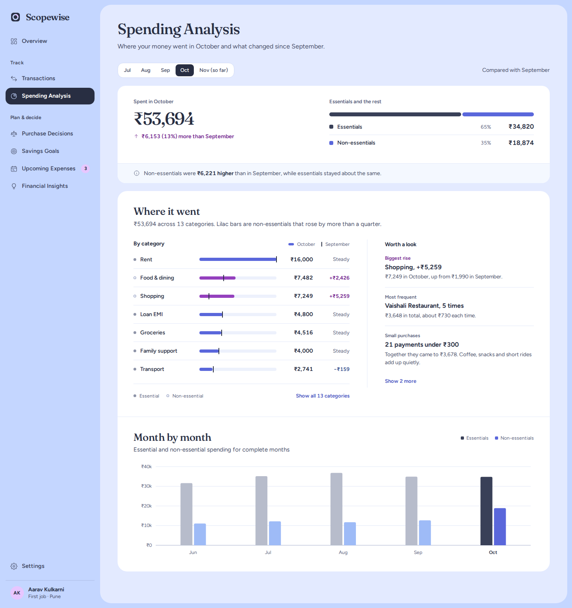

# Spending Analysis

> **The question this page answers:** "Where did my money go, and is that changing?"

## 1. At a glance

| | |
|---|---|
| **Where to find it** | Sidebar → Track → Spending Analysis |
| **Web address** | `#/spending` |
| **Use it when** | At the end of a month, or when you feel you spent "too much" and want to know on what |
| **Main actions** | Pick a month |
| **Saves data?** | No, read-only |

## 2. Page layout

1. **Header and month switch:** a one-line description, the **month switch** and a note of which month it is compared with
2. **Summary card:** the total spent, its change against the month before, the essentials vs non-essentials split, and a one-line comparison
3. **Where it went** (left): spending by category against the month before
4. **Worth a look** (right): what stands out in the month
5. **Month by month** (below, full width): a bar chart of complete months

On a tablet or phone the columns stack: the summary card, then categories, then Worth a look, then the chart.

## 3. Features

### 3.1 Month switch
- **What it does:** switches every part of the page to another month.
- **How to use it:** click a month in the switch at the top left. It shows up to the **last 5 months** that have spending. The current month is labelled **(so far)**. The text beside it says which month you are being compared with.
- **Good to know:** the page opens on the most recent **complete** month, not the current partial one.

### 3.2 Summary card
- **Total:** "Spent in October" with the amount. For the current month it reads "Spent so far in November".
- **Change line:** under the total, for example "↑ ₹6,153 (13%) more than September". It is lilac when spending rose, periwinkle when it fell and grey when it is about the same (under 1%). For the current month it shows last month's total instead, because a partial month isn't a fair comparison.
- **Essentials vs non-essentials:** a two-part bar with a row for each: **Essentials** (rent, bills, groceries, transport…) and **Non-essentials** (eating out, shopping, fun…), each with its share and amount. Hover a row to see which categories it covers.
- **Comparison note:** the strip along the bottom, for example "Non-essentials were **₹X higher** than in September, while essentials stayed about the same". For the current month it shows last month's non-essential total instead.

### 3.3 Where it went
- **What it does:** lists categories with spending this month or last month, largest first. The **7 largest** show first; **Show all N categories** opens the rest.
  - **Bar:** the selected month. **Black tick on the bar:** where the month before ended.
  - **Amount**, then the change: `+₹1,200`, `−₹300`, **Steady** (under ₹100 either way) or **New**.
  - **Dot:** filled navy-grey for essential, hollow for non-essential.
- **Good to know:** a bar and its change turn **lilac** only when a **non-essential** category rose by **more than 25%** (and at least ₹100). Falls of more than ₹100 are shown in periwinkle.

### 3.4 Worth a look
Findings for the selected month. The first three show; **Show N more** opens the rest.

| Finding | Shown when | Example |
|---|---|---|
| **Biggest rise** | A complete month where one category rose by more than ₹500 | "Shopping, +₹5,259 · ₹7,249 in October, up from ₹1,990 in September" |
| **Most frequent** | One place appears 3+ times (bills excluded) | "Swiggy, 9 times · ₹3,400 in total, about ₹380 each time" |
| **Small purchases** | 5+ payments under ₹300 | "14 payments under ₹300 · together …" |
| **Weekends** | Any flexible spending | "42% of flexible spending" happened on Saturday or Sunday |
| **Largest one-off** | Any non-bill expense | The biggest single purchase, its category and date |

### 3.5 Month by month chart
- **What it does:** bars for up to the **last 6 complete months**, showing essentials and non-essentials side by side.
- **How to use it:** hover over (or tap) a bar for a tooltip with essentials, non-essentials and the total. The selected month is highlighted.
- **Good to know:** the chart needs at least **2 complete months**.

## 4. Step-by-step tasks

**How to see why last month cost more**
1. Open Spending Analysis. It opens on last month.
2. Read the change line in the summary card.
3. In **Where it went**, look for lilac bars and changes.
4. Check **Worth a look** for the biggest rise, frequent places and small purchases.

**How to compare two months**
1. Choose the later month in the month switch.
2. Each category shows that month as a bar, with a tick marking where the month before ended.

**How to check this month so far**
1. Click the month marked **(so far)**.

## 5. How the numbers are worked out

| Figure | Source |
|---|---|
| Category totals | Sum of expense transactions in each category for the month |
| Essential / non-essential | Based on each category's essential flag ([Core concepts §4](01-core-concepts.md#4-categories)) |
| Change | This month's category total − last month's |
| Weekend share | Flexible spending on Sat/Sun ÷ all flexible spending |

Transfers to savings and income aren't counted as spending.

## 6. Empty and special states

| Situation | What you see |
|---|---|
| No expenses recorded | "No spending recorded yet" with **Add transactions** |
| Only one month of data | No ticks or change figures, and the card says there is no earlier month to compare with |
| Fewer than 2 complete months | The chart shows "The chart appears once you have two complete months." |

## 7. Links to other pages

| From this page | Goes to | Why |
|---|---|---|
| Empty state button | Transactions | Add data |
| *(arrive from)* Overview, Insights | — | "Spending analysis →" and "See spending by category" links |

## 8. Tips and FAQ

- **Why doesn't the page open on this month?** A partial month always looks cheaper. Complete months give a fair comparison.
- **Why is rent missing from "Largest one-off"?** Rent and regular bills are left out so the pattern shows choices you actually make.
- **Is "Gifts" essential?** No. Only rent, bills, EMI, insurance, education, family support, groceries, transport and health are essential.
